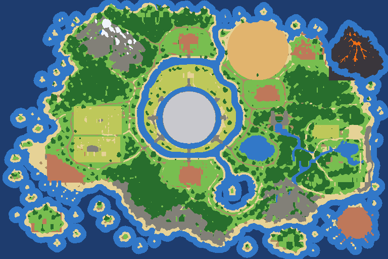
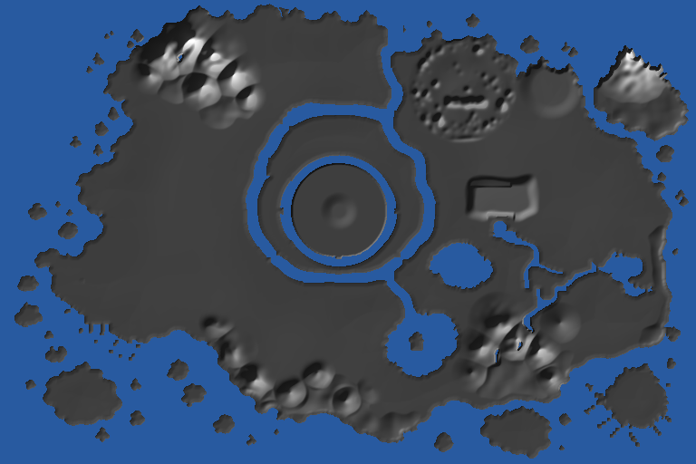

# Fasa 2 — Peta Rujukan Berkoordinat (MASTER MAP)

Dijana oleh `tools/gen_world.py` daripada `reference/master-map.png` + data tulisan tangan `tools/world_ref.py`. Jangan sunting dengan tangan; ubah `world_ref.py` dan jalankan semula.

## 1. Skala & sistem koordinat

| Perkara | Nilai |
|---|---|
| Gambar rujukan | 1536 × 1024 piksel |
| Skala dunia | **1 piksel = 0.8 m** → pulau teras 1229 m × 819 m (1.01 km²) |
| Penukaran | x = 0.8·px -1096 · z = 0.8·py -422 (meter; +x timur, +z selatan) |
| Asal (0, 0) | pintu rumah Waguri (rangka asal v1–v16) = piksel (1370, 528) |
| Grid data | 768 × 512 sel, 1 sel = 1.6 m (tinggi 0.05 m, kelas kawasan, ketumpatan hutan) |
| Julat tinggi | -9.6 m (laut dalam) hingga 77.4 m (Gunung Utara) |

**Kenapa 0.8 m sepiksel?** Kawasan rumah asal (rumah, kebun, pasar, kolam, camp atas bukit) mempunyai saiz tetap dalam meter. Padanan kuasa dua terkecil antara ciri asal dan kelompok timur peta (Sawah, Pasar, Camp, Kolam) memberi skala ≈0.8 m/px dengan ralat 3–9 m. Skala V17 lama (0.5 m/px) menjadikan kawasan asal 1.6× terlalu besar berbanding peta.

## 2. Lokasi wajib (36) + lokasi tambahan v17 (2)

`Sauh` = pusat ciri sebenar yang dilukis (pusat kampung, mulut gua, kepala air terjun, pusat tasik). `Label` = kedudukan teks nama pada peta.

| # | Lokasi | Ikon | Kawasan | Sauh (px) | Label (px) | Dunia x, z (m) |
|---|---|---|---|---|---|---|
| 1 | Kerajaan | 🏰 | Tengah | 748, 465 | 744, 465 | -497.6, -50.0 |
| 2 | Sawah Padi | 🌾 | Tengah | 742, 318 | 742, 308 | -502.4, -167.6 |
| 3 | Gunung Utara | 🏔 | Utara | 415, 92 | 424, 178 | -764.0, -348.4 |
| 4 | Gua Salji | ❄️ | Utara | 532, 214 | 504, 253 | -670.4, -250.8 |
| 5 | Laluan Hutan Jauh | 🌲 | Utara | 560, 132 | 612, 68 | -648.0, -316.4 |
| 6 | Kampung Utara | 🏘 | Utara | 745, 165 | 748, 174 | -500.0, -290.0 |
| 7 | Hutan Barat | 🌳 | Barat | 384, 345 | 384, 357 | -788.8, -146.0 |
| 8 | Kebun Buah | 🍎 | Barat | 385, 478 | 375, 486 | -788.0, -39.6 |
| 9 | Kandang Lembu | 🐄 | Barat | 385, 592 | 375, 600 | -788.0, 51.6 |
| 10 | Pantai Barat | 🏖 | Barat | 150, 600 | 158, 608 | -976.0, 58.0 |
| 11 | Pelabuhan Barat | ⚓ | Barat | 268, 676 | 240, 715 | -881.6, 118.8 |
| 12 | Padang Pasir | 🏜 | Timur | 1020, 195 | 1015, 226 | -280.0, -266.0 |
| 13 | Runtuhan Purba | 🏛 | Timur | 1215, 192 | 1240, 236 | -124.0, -268.4 |
| 14 | Kawasan Larangan | 🌋 | Timur | 1395, 128 | 1418, 244 | 20.0, -319.6 |
| 15 | Kampung Timur | 🏘 | Timur | 1055, 366 | 1060, 374 | -252.0, -129.2 |
| 16 | Hutan Timur | 🌳 | Timur | 1278, 352 | 1278, 366 | -73.6, -140.4 |
| 17 | Hutan Utara | 🌳 | Timur | 1395, 440 | 1395, 451 | 20.0, -70.0 |
| 18 | Air Terjun | 💦 | Timur | 1082, 500 | 1108, 494 | -230.4, -22.0 |
| 19 | Tasik Biru | 💧 | Timur | 1023, 592 | 1027, 587 | -277.6, 51.6 |
| 20 | Sawah | 🌾 | Timur | 1290, 512 | 1290, 520 | -64.0, -12.4 |
| 21 | Pasar | 🛒 | Timur | 1413, 522 | 1415, 522 | 34.4, -4.4 |
| 22 | Camp | ⛺ | Timur | 1302, 576 | 1300, 578 | -54.4, 38.8 |
| 23 | Kolam | 🪷 | Timur | 1385, 592 | 1373, 593 | 12.0, 51.6 |
| 24 | Paya Bakau | 🐊 | Timur | 1165, 640 | 1192, 637 | -164.0, 90.0 |
| 25 | Puncak | ⛰ | Timur | 1322, 640 | 1325, 640 | -38.4, 90.0 |
| 26 | Bukit | ⛰ | Timur | 1236, 712 | 1238, 718 | -107.2, 147.6 |
| 27 | Kawasan Turun Bukit | 🥾 | Timur | 1385, 712 | 1395, 720 | 12.0, 147.6 |
| 28 | Pantai Timur | 🏖 | Timur | 1452, 600 | 1482, 594 | 65.6, 58.0 |
| 29 | Kampung Selatan | 🏘 | Selatan | 748, 690 | 750, 690 | -497.6, 130.0 |
| 30 | Hutan Selatan | 🌳 | Selatan | 600, 760 | 607, 764 | -616.0, 186.0 |
| 31 | Gua Selatan | 🕳 | Selatan | 718, 852 | 715, 876 | -521.6, 259.6 |
| 32 | Tasik Sunyi | 💧 | Selatan | 925, 785 | 923, 773 | -356.0, 206.0 |
| 33 | Gunung Selatan | 🏔 | Selatan | 1105, 722 | 1142, 800 | -212.0, 155.6 |
| 34 | Pulau Kecil | 🏝 | Pulau | 180, 875 | 176, 886 | -952.0, 278.0 |
| 35 | Pulau Rahsia | 🌀 | Pulau | 1145, 945 | 1142, 955 | -180.0, 334.0 |
| 36 | Pulau Lanun | 🏴‍☠️ | Pulau | 1418, 888 | 1415, 890 | 38.4, 288.4 |
| 37 | Rumah Api | 🗼 | Barat | 112, 562 | 112, 562 | -1006.4, 27.6 |
| 38 | Air Terjun Barat | 💦 | Barat | 300, 205 | 300, 205 | -856.0, -258.0 |

## 3. Sambungan geografi kritikal

- **Kerajaan** di tengah: kota bulat jejari 80 m, tembok + 8 pintu, istana di tengah (-498, -52) m; **terusan dalam** (cincin 106–123 px dari pusat) dan **terusan luar** (bentuk ikut peta) dengan 16 lintasan jambatan pada 8 jalan jejari.
- **Sungai utara** dari terusan luar ke laut utara (antara Kampung Utara dan Padang Pasir); **sungai tenggara** dari terusan luar ke **Tasik Sunyi**.
- **Air Terjun**: dataran tinggi 15 m (sumber + kolam mata air) → tebing → kolam air terjun (-214, -20) m → sungai mengalir ke tenggara melalui **Paya Bakau** ke kelompok timur.
- **Padang Pasir** kekal di timur laut (pusat -280, -266 m, jejari 98 m); **Runtuhan Purba** di timurnya dengan jambatan ke **Kawasan Larangan** (pulau gunung berapi).
- **Pulau Lanun** di tenggara luar pantai, disambung jambatan panjang dari Kawasan Turun Bukit. **Pelabuhan Barat** di pesisir barat daya.
- **Gunung Utara** (puncak 78 m) dan **Gunung Selatan** (puncak 58 m) dibina sebagai rupa bumi 3D; tebing berbatu sepanjang pantai selatan (Gua Selatan).

## 4. Jalan (40) & jambatan bernama (24)

| Jalan | Jenis | Titik kawalan (px) |
|---|---|---|
| Jalan Diraja Utara | diraja 5 m | (748,364) → (747,340) → (747,300) → (747,282) → (747,260) → (747,228) → (746,210) |
| Jalan Diraja Selatan | diraja 5 m | (749,562) → (747,580) → (747,600) → (747,625) → (748,642) |
| Jalan Diraja Timur | diraja 5 m | (850,463) → (868,465) → (907,466) → (946,467) → (989,468) → (1000,470) |
| Jalan Diraja Barat | diraja 5 m | (650,463) → (625,464) → (574,466) → (542,462) → (515,467) → (483,464) |
| Jalan Diraja Timur Laut | diraja 5 m | (830,410) → (842,401) → (856,392) → (880,380) → (915,377) → (950,377) → (963,378) |
| Jalan Diraja Barat Laut | diraja 5 m | (672,408) → (651,398) → (630,392) → (612,375) → (598,357) → (581,351) → (544,349) |
| Jalan Diraja Tenggara | diraja 5 m | (826,528) → (839,534) → (860,550) → (885,569) → (905,578) → (916,584) |
| Jalan Diraja Barat Daya | diraja 5 m | (672,520) → (653,531) → (628,548) → (605,564) → (585,580) → (572,594) |
| Jalan Pasir Timur Laut | diraja 5 m | (860,352) → (877,333) → (899,311) → (908,301) |
| Lingkaran Sawah Padi | kampung 3.4 m | (619,402) → (610,380) → (614,357) → (652,292) → (689,284) → (741,282) → (752,282) → (800,284) → (831,291) → (852,326) → (868,347) → (869,355) |
| Lingkaran Sawah Timur | kampung 3.4 m | (854,392) → (836,407) → (838,414) → (852,446) → (852,462) → (878,464) |
| Lingkaran Sawah Selatan | kampung 3.4 m | (833,529) → (820,540) → (795,554) → (764,590) → (740,588) → (720,582) → (701,580) → (675,565) → (665,563) |
| Jalan Sawah Padi | denai 2.4 m | (774,344) → (786,343) → (827,361) → (851,383) → (854,391) |
| Jalan Kampung Utara | kampung 3.4 m | (645,160) → (647,151) → (655,139) → (678,119) → (692,113) → (701,110) → (734,105) → (764,109) → (780,107) → (818,121) → (832,142) → (868,147) → (910,147) |
| Jalan Kampung Utara Selatan | kampung 3.4 m | (632,207) → (656,206) → (675,211) → (692,216) → (717,215) → (733,220) → (746,215) → (774,218) → (797,216) → (827,221) → (864,242) → (879,255) → (896,262) → (902,272) → (960,314) |
| Jalan Pantai Utara | denai 2.4 m | (780,107) → (802,82) → (807,69) |
| Jalan Gua Salji | kampung 3.4 m | (431,268) → (438,276) → (469,293) → (493,313) → (526,324) → (527,324) → (577,293) → (596,277) → (606,264) → (618,265) → (652,291) |
| Jalan Hutan Barat | kampung 3.4 m | (607,263) → (613,235) → (632,207) → (632,205) → (630,175) |
| Jalan Kebun Buah | kampung 3.4 m | (348,429) → (382,423) → (396,415) → (419,410) → (451,410) → (503,402) → (512,399) → (529,374) → (534,354) → (544,349) |
| Lingkaran Kebun Buah | kampung 3.4 m | (483,464) → (481,531) → (505,520) → (514,520) → (557,574) → (572,594) → (585,604) → (602,631) → (624,640) → (648,643) |
| Jalan Kandang Lembu | kampung 3.4 m | (481,531) → (440,536) → (400,538) → (340,538) → (288,534) → (281,492) → (279,488) → (281,467) → (288,453) → (288,446) → (267,448) → (246,456) |
| Jalan Pantai Barat | kampung 3.4 m | (288,534) → (265,581) → (232,589) |
| Jalan Pelabuhan | kampung 3.4 m | (466,643) → (421,653) → (409,662) → (390,668) → (355,665) → (354,666) → (335,695) → (333,720) |
| Jalan Kampung Timur | kampung 3.4 m | (980,314) → (1038,307) → (1056,308) → (1061,305) → (1068,308) → (1095,309) → (1105,304) → (1132,274) → (1139,273) → (1152,264) → (1200,262) → (1250,275) → (1316,301) → (1337,300) |
| Jalan Barat Kampung Timur | kampung 3.4 m | (995,428) → (974,405) → (964,386) → (960,357) → (963,324) → (960,314) |
| Jalan Air Terjun | kampung 3.4 m | (1004,430) → (1059,428) → (1074,426) → (1081,422) → (1094,423) → (1123,418) → (1138,403) → (1165,402) → (1192,408) → (1224,406) → (1241,410) → (1251,417) → (1273,425) → (1321,429) |
| Jalan Hutan Utara | kampung 3.4 m | (1322,429) → (1358,417) → (1410,412) → (1432,425) → (1436,433) |
| Jalan Pasar | kampung 3.4 m | (1322,430) → (1332,455) → (1334,471) → (1335,472) → (1365,484) → (1387,499) |
| Jalan Sawah Timur | kampung 3.4 m | (1215,588) → (1210,553) → (1214,516) → (1221,497) → (1228,488) → (1244,478) → (1284,479) → (1286,479) → (1301,477) → (1307,480) → (1334,472) |
| Jalan Kampung Timur Utara | denai 2.4 m | (1129,397) → (1125,340) → (1095,309) |
| Jalan Runtuhan | denai 2.4 m | (1250,275) → (1262,240) → (1270,218) → (1292,213) → (1322,213) → (1342,218) |
| Jalan Tasik Biru | kampung 3.4 m | (989,468) → (988,490) → (973,525) → (958,545) → (944,571) → (944,636) → (987,652) → (1036,661) → (1059,654) → (1070,647) → (1080,646) → (1092,654) → (1105,658) → (1136,655) → (1144,658) → (1170,662) |
| Jalan Tasik Biru Utara | denai 2.4 m | (997,488) → (1028,506) → (1039,512) → (1055,520) → (1064,545) → (1092,570) → (1102,588) → (1098,619) → (1081,645) |
| Jalan Tasik Sunyi | kampung 3.4 m | (916,584) → (917,600) → (922,613) → (944,636) → (934,657) → (924,667) → (860,688) → (857,699) → (848,717) → (827,742) → (826,793) → (830,802) → (851,822) → (875,833) → (886,839) → (903,847) → (924,850) → (956,841) → (977,829) → (997,817) → (1019,789) → (1029,739) → (1034,733) → (1043,687) → (1037,662) |
| Jalan Gunung Selatan | denai 2.4 m | (1035,734) → (1055,729) → (1067,722) → (1084,724) |
| Jalan Kampung Selatan | kampung 3.4 m | (648,643) → (662,639) → (720,637) → (748,640) → (792,637) → (832,639) → (851,664) → (860,688) |
| Jalan Kampung Selatan Bawah | kampung 3.4 m | (640,694) → (643,705) → (647,715) → (661,727) → (666,727) → (703,740) → (738,742) → (748,750) → (755,742) → (826,742) |
| Jalan Gua Selatan | denai 2.4 m | (748,752) → (756,784) → (757,785) → (778,792) → (802,793) → (821,798) |
| Jalan Bukit | denai 2.4 m | (1170,662) → (1197,700) → (1192,718) → (1197,738) |
| Jambatan Pulau Lanun | diraja 5 m | (1336,758) → (1358,772) → (1384,819) → (1398,836) |
| Laluan Hutan Jauh | denai 2.8 m | (640,168) → (629,174) → (600,168) → (572,146) → (552,141) → (532,132) → (512,120) → (456,98) → (428,70) → (395,60) → (372,72) → (338,100) → (300,130) → (290,175) → (288,200) → (284,224) → (282,240) → (296,280) → (270,305) → (250,332) → (232,380) → (226,425) → (246,456) → (267,448) → (288,446) |

Jambatan dibina **automatik** di setiap tempat jalan merentas air (tiada jalan memotong air tanpa jambatan) dan diberi nama jambatan bernama terdekat:

| Jambatan | Piksel | Dunia x, z (m) |
|---|---|---|
| Jambatan Utara | 747, 242 | -498.4, -228.4 |
| Jambatan Diraja | 746, 356 | -499.2, -137.2 |
| Jambatan Selatan | 747, 613 | -498.4, 68.4 |
| Jambatan Istana Selatan | 747, 571 | -498.4, 34.8 |
| Jambatan Jalan Baru | 946, 467 | -339.2, -48.4 |
| Jambatan Istana Timur | 868, 465 | -401.6, -50.0 |
| Jambatan Barat | 556, 465 | -651.2, -50.0 |
| Jambatan Istana Barat | 625, 464 | -596.0, -50.8 |
| Jambatan Hutan | 581, 351 | -631.2, -141.2 |
| Jambatan Istana Barat Laut | 651, 398 | -575.2, -103.6 |
| Jambatan Kampung Timur | 932, 377 | -350.4, -120.4 |
| Jambatan Istana Timur Laut | 842, 401 | -422.4, -101.2 |
| Jambatan Tenggara | 885, 569 | -388.0, 33.2 |
| Jambatan Istana Tenggara | 839, 534 | -424.8, 5.2 |
| Jambatan Barat Daya | 605, 564 | -612.0, 29.2 |
| Jambatan Istana Barat Daya | 653, 531 | -573.6, 2.8 |
| Jambatan Gua Salji | 631, 276 | -591.2, -201.2 |
| Jambatan Padang Pasir | 887, 322 | -386.4, -164.4 |
| Jambatan Sungai Utara | 853, 144 | -413.6, -306.8 |
| Jambatan Kuala Utara | 853, 236 | -413.6, -233.2 |
| Jambatan Paya Bakau | 1190, 657 | -144.0, 103.6 |
| Jambatan Larangan | 1306, 213 | -51.2, -251.6 |
| Jambatan Pulau Lanun | 1371, 796 | 0.8, 214.8 |
| Jambatan Tasik Sunyi | 858, 615 | -409.6, 70.0 |

## 5. Gunung, bukit & dataran (tinggi ditetapkan tangan — peta 2D tiada ketinggian)

| Kawasan | Puncak (px) | Tinggi | Jejari |
|---|---|---|---|
| Gunung Utara | 415, 88 | 78 m | 76 m |
| Gunung Utara | 468, 120 | 70 m | 64 m |
| Gunung Utara | 362, 120 | 58 m | 56 m |
| Gunung Utara | 515, 165 | 52 m | 50 m |
| Gunung Utara | 446, 190 | 46 m | 46 m |
| Gunung Utara | 330, 165 | 34 m | 36 m |
| Gunung Utara | 548, 212 | 34 m | 32 m |
| Gunung Selatan | 1100, 712 | 58 m | 56 m |
| Gunung Selatan | 1140, 748 | 52 m | 48 m |
| Gunung Selatan | 1062, 765 | 46 m | 44 m |
| Gunung Selatan | 1188, 772 | 40 m | 40 m |
| Gunung Selatan | 1215, 836 | 26 m | 32 m |
| Gunung Selatan | 1040, 822 | 30 m | 36 m |
| Tebing Selatan | 478, 712 | 22 m | 32 m |
| Tebing Selatan | 520, 770 | 28 m | 40 m |
| Tebing Selatan | 562, 838 | 32 m | 38 m |
| Tebing Selatan | 640, 866 | 28 m | 34 m |
| Tebing Selatan | 700, 822 | 30 m | 32 m |
| Tebing Selatan | 762, 884 | 22 m | 30 m |
| Tebing Selatan | 820, 858 | 20 m | 27 m |
| Tebing Selatan | 600, 905 | 18 m | 24 m |
| Kawasan Larangan | 1395, 118 | 72 m | 90 m |
| Bukit | 1236, 712 | 18 m | 37 m |
| Runtuhan Purba | 1215, 192 | 7 m | 58 m |

## 6. Imej grid yang dijana

Kelas kawasan (laut dalam, air, pasir, rumput, hutan, sawah, batu, salji, padang pasir, lava, kampung, Kerajaan, jalan, basalt):

Ketinggian (berlorek):

