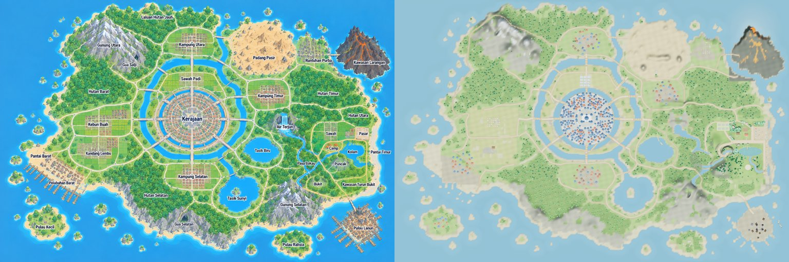
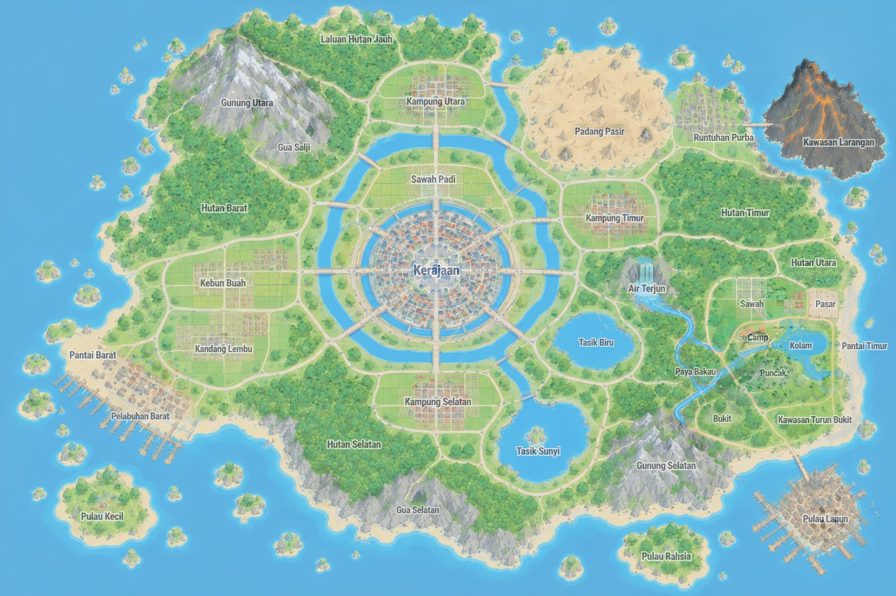
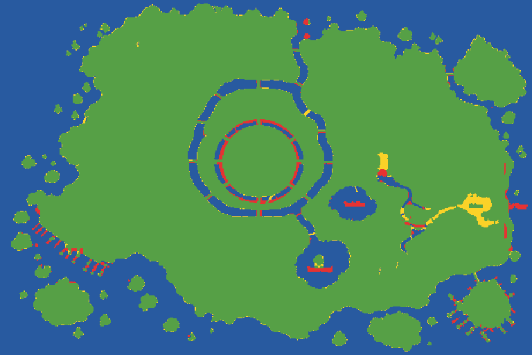
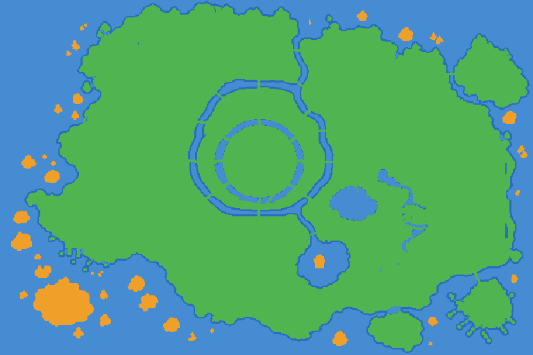

# Fasa 2 — Laporan Semakan Peta (MASTER MAP ↔ dunia 3D)

Dijana oleh `tools/verify-map.mjs` + `tools/verify_map.py` daripada **game sebenar** (build `dist/Kediaman_Isekai_Waguri_v19.html`, Chromium headless, tahap grafik Biasa). Jangan sunting dengan tangan — jalankan semula alat.

## 1. Ringkasan

| Semakan | Keputusan | Ambang lulus | Status |
|---|---|---|---|
| IoU darat/air (fizik dunia vs MASTER MAP) | 0.968 | ≥ 0.95 | ✅ |
| F1 garis pantai, toleransi 4 m (fizik) | 0.913 | ≥ 0.85 | ✅ |
| F1 garis pantai, toleransi 8 m (fizik) | 0.953 | ≥ 0.95 | ✅ |
| IoU darat/air (warna tangkapan top-down) | 0.945 | ≥ 0.90 | ✅ |
| Lokasi (36 wajib + 2 lokasi v17) wujud di koordinat peta, ada pin, boleh dicapai | 38 / 38 | semua | ✅ |
| Jambatan wajib (misi & laluan pulau) | 6 / 6 | semua | ✅ |
| Jalan merentas air tanpa jambatan | 0 | 0 | ✅ |
| Air terjun dengan sumber di kawasan tinggi | 2 dibina | ≥ 1 | ✅ |
| Darat boleh dicapai berjalan kaki dari rumah | 93.7 % | ≥ 85 % | ✅ |

## 2. Perbandingan visual

Kiri: MASTER MAP · Kanan: tangkapan top-down dunia 3D (kamera ortografik, 1 piksel = 0.8 m, sejajar dengan peta).

Tindihan separa lut sinar 50 % (MASTER MAP + dunia 3D):

Beza garis pantai (data fizik): 🟩 darat di kedua-dua · 🟦 air di kedua-dua · 🟥 darat dalam peta tetapi air dalam game · 🟨 air dalam peta tetapi darat dalam game.

Kebolehcapaian dari pintu rumah Waguri: 🟩 berjalan kaki · 🟧 perlu berenang/bot · 🟥 tidak dapat dicapai · biru = air.

## 3. Senarai semak lokasi

`ralat` = jarak antara kedudukan lokasi dalam game dan titik sauh pada MASTER MAP. `pin` = anjakan pin peta (pin dialih ke darat terdekat bila perlu). `label` = jarak teks label peta ke titik sauh ciri.

| # | Lokasi | Kawasan | Piksel peta | Dunia (x, z) m | Ralat | Pin | Label | Tinggi | Capaian | Status |
|---|---|---|---|---|---|---|---|---|---|---|
| 1 | Kerajaan | Tengah | 748, 465 | -497.6, -50.0 | 0.0 m | 0.0 m | 3 m | 9.09 m | kaki | ✅ |
| 2 | Sawah Padi | Tengah | 742, 318 | -502.4, -167.6 | 0.0 m | 0.0 m | 8 m | 1.92 m | kaki | ✅ |
| 3 | Gunung Utara | Utara | 415, 92 | -764.0, -348.4 | 0.0 m | 3.0 m | 69 m | 72.7 m | kaki | ✅ |
| 4 | Gua Salji | Utara | 532, 214 | -670.4, -250.8 | 0.0 m | 7.5 m | 38 m | 19.19 m | kaki | ✅ |
| 5 | Laluan Hutan Jauh | Utara | 560, 132 | -648.0, -316.4 | 0.0 m | 142.7 m | 66 m | 4.62 m | kaki | ✅ |
| 6 | Kampung Utara | Utara | 745, 165 | -500.0, -290.0 | 0.0 m | 0.0 m | 8 m | 2.38 m | kaki | ✅ |
| 7 | Hutan Barat | Barat | 384, 345 | -788.8, -146.0 | 0.0 m | 0.0 m | 10 m | 4.85 m | kaki | ✅ |
| 8 | Kebun Buah | Barat | 385, 478 | -788.0, -39.6 | 0.0 m | 0.0 m | 10 m | 4.52 m | kaki | ✅ |
| 9 | Kandang Lembu | Barat | 385, 592 | -788.0, 51.6 | 0.0 m | 0.0 m | 10 m | 4.15 m | kaki | ✅ |
| 10 | Pantai Barat | Barat | 150, 600 | -976.0, 58.0 | 0.0 m | 0.0 m | 9 m | 1.81 m | kaki | ✅ |
| 11 | Pelabuhan Barat | Barat | 268, 676 | -881.6, 118.8 | 0.0 m | 0.0 m | 38 m | 2.86 m | kaki | ✅ |
| 12 | Padang Pasir | Timur | 1020, 195 | -280.0, -266.0 | 0.0 m | 0.0 m | 25 m | 4.42 m | kaki | ✅ |
| 13 | Runtuhan Purba | Timur | 1215, 192 | -124.0, -268.4 | 0.0 m | 0.0 m | 40 m | 9.25 m | kaki | ✅ |
| 14 | Kawasan Larangan | Timur | 1395, 128 | 20.0, -319.6 | 0.0 m | 3.0 m | 95 m | 51.8 m | kaki | ✅ |
| 15 | Kampung Timur | Timur | 1055, 366 | -252.0, -129.2 | 0.0 m | 0.0 m | 8 m | 4.15 m | kaki | ✅ |
| 16 | Hutan Timur | Timur | 1278, 352 | -73.6, -140.4 | 0.0 m | 0.0 m | 11 m | 3.87 m | kaki | ✅ |
| 17 | Hutan Utara | Timur | 1395, 440 | 20.0, -70.0 | 0.0 m | 0.0 m | 9 m | 2.28 m | kaki | ✅ |
| 18 | Air Terjun | Timur | 1082, 500 | -230.4, -22.0 | 0.0 m | 0.0 m | 21 m | 1.73 m | kaki | ✅ |
| 19 | Tasik Biru | Timur | 1023, 592 | -277.6, 51.6 | 0.0 m | 34.5 m | 5 m | -3.3 m | renang/bot | ✅ |
| 20 | Sawah | Timur | 1290, 512 | -64.0, -12.4 | 0.0 m | 4.1 m | 6 m | 0 m | kaki | ✅ |
| 21 | Pasar | Timur | 1413, 522 | 34.4, -4.4 | 0.0 m | 4.7 m | 2 m | 0 m | kaki | ✅ |
| 22 | Camp | Timur | 1302, 576 | -54.4, 38.8 | 0.0 m | 8.2 m | 2 m | 20 m | kaki | ✅ |
| 23 | Kolam | Timur | 1385, 592 | 12.0, 51.6 | 0.0 m | 15.6 m | 10 m | 0 m | kaki | ✅ |
| 24 | Paya Bakau | Timur | 1165, 640 | -164.0, 90.0 | 0.0 m | 7.5 m | 22 m | -0.01 m | kaki | ✅ |
| 25 | Puncak | Timur | 1322, 640 | -38.4, 90.0 | 0.0 m | 42.7 m | 2 m | 6.56 m | kaki | ✅ |
| 26 | Bukit | Timur | 1236, 712 | -107.2, 147.6 | 0.0 m | 0.0 m | 5 m | 18.96 m | kaki | ✅ |
| 27 | Kawasan Turun Bukit | Timur | 1385, 712 | 12.0, 147.6 | 0.0 m | 0.0 m | 10 m | 2.39 m | kaki | ✅ |
| 28 | Pantai Timur | Timur | 1452, 600 | 65.6, 58.0 | 0.0 m | 36.4 m | 24 m | -0.01 m | kaki | ✅ |
| 29 | Kampung Selatan | Selatan | 748, 690 | -497.6, 130.0 | 0.0 m | 0.0 m | 2 m | 2.63 m | kaki | ✅ |
| 30 | Hutan Selatan | Selatan | 600, 760 | -616.0, 186.0 | 0.0 m | 0.0 m | 6 m | 4.24 m | kaki | ✅ |
| 31 | Gua Selatan | Selatan | 718, 852 | -521.6, 259.6 | 0.0 m | 0.0 m | 19 m | 6.09 m | kaki | ✅ |
| 32 | Tasik Sunyi | Selatan | 925, 785 | -356.0, 206.0 | 0.0 m | 10.5 m | 10 m | -1.6 m | renang/bot | ✅ |
| 33 | Gunung Selatan | Selatan | 1105, 722 | -212.0, 155.6 | 0.0 m | 1.5 m | 69 m | 35.69 m | kaki | ✅ |
| 34 | Pulau Kecil | Pulau | 180, 875 | -952.0, 278.0 | 0.0 m | 0.0 m | 9 m | 3.43 m | renang/bot | ✅ |
| 35 | Pulau Rahsia | Pulau | 1145, 945 | -180.0, 334.0 | 0.0 m | 0.0 m | 8 m | 3.06 m | kaki | ✅ |
| 36 | Pulau Lanun | Pulau | 1418, 888 | 38.4, 288.4 | 0.0 m | 0.0 m | 3 m | 2.27 m | kaki | ✅ |
| 37 | Rumah Api | Barat | 112, 562 | -1006.4, 27.6 | 0.0 m | 0.0 m | 0 m | 2.25 m | kaki | ✅ |
| 38 | Air Terjun Barat | Barat | 300, 205 | -856.0, -258.0 | 0.0 m | 1.5 m | 0 m | 2.13 m | kaki | ✅ |

## 4. Jalan, sungai & jambatan

- Jalan dalam game: **42** (40 dijejak daripada MASTER MAP + Laluan Hutan Jauh 2 bahagian).
- Jambatan/jeti dibina: **33**; jambatan bernama ikut peta: Jambatan Barat, Jambatan Barat Daya, Jambatan Diraja, Jambatan Gua Salji, Jambatan Hutan, Jambatan Istana Barat, Jambatan Istana Barat Daya, Jambatan Istana Barat Laut, Jambatan Istana Selatan, Jambatan Istana Tenggara, Jambatan Istana Timur, Jambatan Istana Timur Laut, Jambatan Jalan Baru, Jambatan Kampung Timur, Jambatan Kuala Utara, Jambatan Larangan, Jambatan Padang Pasir, Jambatan Paya Bakau, Jambatan Pulau Lanun, Jambatan Selatan, Jambatan Sungai Utara, Jambatan Tenggara, Jambatan Utara.
- Jambatan wajib: ✅ Jambatan Camp, ✅ Jambatan Hutan, ✅ Jambatan Jalan Baru, ✅ Jambatan Paya Bakau, ✅ Jambatan Pulau Lanun, ✅ Jambatan Larangan.
- Jalan merentas air tanpa jambatan: **tiada** ✅.
- Air terjun: (-209, -52) puncak 17.6 m; (-848, -272) puncak 5.4 m.
- Bendera Laluan Hutan Jauh: tjn (-774, -372) tinggi 24.0 m, tjw (-890, -161) tinggi 1.9 m, tjs (-842, 176) tinggi 2.5 m.

## 5. Had yang diketahui (jujur)

- Sungai & terusan berada pada paras laut (satah air tunggal); hanya air terjun mempunyai paras tinggi (kolam mata air di atas tebing). Aliran air yang bergerak di sepanjang sungai belum dianimasikan.
- Kawasan rumah asal (rangka v1–v16) dikekalkan tepat seperti v18 di kelompok timur; susun atur dalaman kelompok itu (rumah, kolam besar, camp atas bukit) mengikut permainan asal, bukan lukisan baharu dalam peta, supaya tiada misi/NPC lama rosak.
- Pulau kecil dan Pulau Rahsia hanya boleh dicapai dengan berenang atau sampan (seperti peta: tiada jambatan dilukis).
- Ketinggian gunung, tebing dan dataran ditentukan secara tangan (tools/world_ref.py) kerana peta 2D tidak menyimpan ketinggian.
